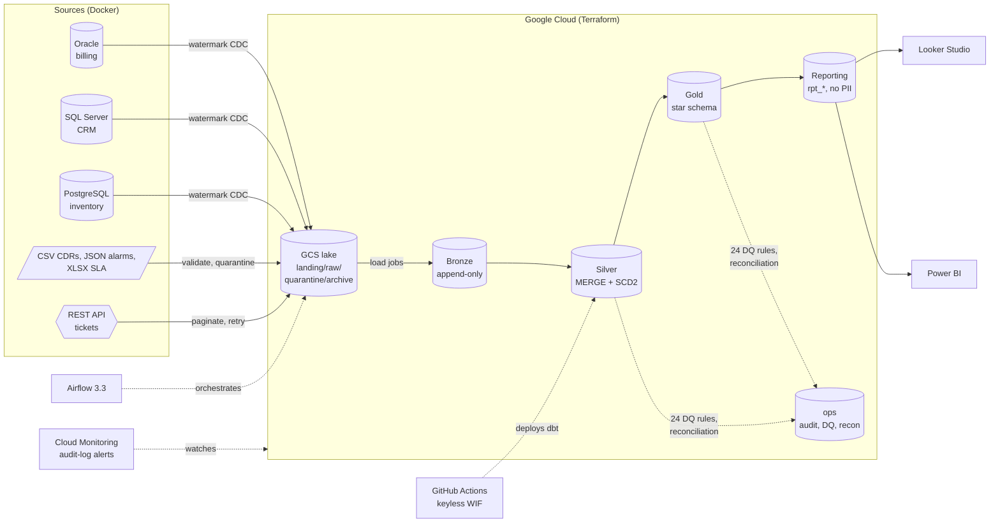

# Telco Data Platform on GCP

End-to-end data engineering platform on **synthetic telecom data** (customers,
billing, CDRs, network faults, tickets, SLAs): Oracle, SQL Server, PostgreSQL,
files and a REST API → GCS/BigQuery medallion → dbt star schema → Looker Studio & Power BI.

Headline use case: **revenue assurance and SLA performance**, reconciling rated
call records against billed invoices, and fault-to-ticket resolution against SLA targets.

## Architecture

## By the numbers
| | |
|---|---|
| Source systems | 7 (3 databases, 3 file formats, 1 REST API) |
| Rows per month | ~1.2M (1.13M call records) |
| dbt | 54 models, 3 SCD2 snapshots, 150+ tests |
| Data quality | 24 rules; **100% of 9,494 injected defects detected, 0 false positives** |
| Reconciliation | 48 checks per run, source -> Bronze -> Silver -> Gold, to the penny |
| Revenue assurance | finds exactly the injected leakage: 127 subscriptions, £350.73 |
| Security | 5 service accounts, no keys anywhere, PII policy tags, row-level security |
| Automated checks | 83 unit tests (incl. Spark), sqlfluff, DAG tests, Terraform validate, on every PR |
| Spark vs SQL | same mart in PySpark: 390/390 day x region groups identical to dbt |
| Monthly cost | inside the GCP free tier (`make cost-report`) |

## Stack
Python · SQL · BigQuery · GCS · Airflow · dbt · PySpark (Dataproc Serverless) · Terraform · Docker · GitHub Actions · Cloud Monitoring · Looker Studio · Power BI

## Documentation
- [Interview guide](docs/interview_guide.md): the project pitch, design stories, likely questions
- [Runbook](docs/runbook.md): what to do when an alert fires
- [Architecture decisions](docs/adr/): 12 ADRs, one per major choice
- [Data model](docs/data_model.md) · [Sources and injected defects](docs/sources.md) · [Dashboards](dashboards/)

## Status
- [x] Phase 0: Foundations (env, GCP project, cost guardrails, repo skeleton)
- [x] Phase 1: Synthetic data with injected defects + Oracle / SQL Server / PostgreSQL / REST API sources
- [x] Phase 2: Terraform - lake bucket, medallion datasets, least-privilege service accounts, Secret Manager
- [x] Phase 3: Ingestion to Bronze - full + incremental (watermark CDC), files with quarantine, paginated API with retries, audit trail
- [x] Phase 4: Orchestration - Airflow 3.3 (Docker), 3 DAGs, retries, webhook alerts, backfill by logical date
- [x] Phase 5: Silver with dbt 1.12 - staging views, incremental MERGE, SCD2 snapshots, 59 tests, asset-triggered DAG
- [x] Phase 6: Gold star schema - 7 dimensions (SCD2 as-of joins, unknown members), 5 facts, revenue-assurance mart, measured partition/cluster savings
- [x] Phase 7: Data quality + reconciliation - 24 rules with tolerances, record-level quarantine, scorecard, source-to-Gold reconciliation, 100% of injected defects detected
- [x] Phase 8: Governance - PII policy tags (column-level security), de-identified BI columns, row-level security by region, custom least-privilege role for dbt
- [x] Phase 9: CI/CD - GitHub Actions with keyless Workload Identity Federation, Terraform plan on PRs, dbt deploy on main, sqlfluff, policy-as-tests
- [ ] Phase 10: Streaming demo with Pub/Sub (optional, skipped for now)
- [x] Phase 11: Dashboards - PII-free reporting layer (tested totals), Looker Studio and Power BI on the same definitions
- [x] Phase 12: Operations - audit-log alerts (pipeline failures, access probing), pipeline health view, cost per dbt model, runbook
- [x] Phase 13: Spark comparison - the same mart in PySpark on Dataproc Serverless, unit-tested, reconciled to dbt to the row

## Source systems
| System | Tech | Data |
|---|---|---|
| CRM | SQL Server 2022 | customers, products, subscriptions |
| Billing | Oracle 23ai Free | accounts, invoices, invoice lines, payments |
| Network inventory | PostgreSQL 16 | sites, cells, devices |
| Mediation | CSV files | ~1.1M call detail records / month |
| Network management | Nested JSON | alarm exports |
| Service management | XLSX | SLA targets |
| Ticketing | REST API (FastAPI) | trouble tickets, paginated |

20 kinds of data defect are deliberately injected and logged, so later phases can prove
the data quality checks catch them. See [docs/sources.md](docs/sources.md).

## Quick start
    cp .env.example .env   # set GCP_PROJECT_ID
    make setup
    make test
    make check             # Phase 0 checks
    make phase1            # generate data, start sources, load, verify
    make tf-init tf-plan tf-apply secrets-push verify2   # GCP infrastructure
    make drop-files ingest verify3                       # sources -> Bronze
    make ingest-local                                    # same pipeline offline, no GCP
    make airflow-env airflow-build airflow-up            # Airflow UI on http://localhost:8080
    make dbt-debug dbt-build                             # Bronze -> Silver -> Gold
    make cost-compare                                    # measured partitioning savings
    make dq-capture dq-build verify7                     # DQ rules, reconciliation, defect report
    make governance-env dbt-build verify8                # policy tags, masking, row-level security
    make ci-local                                        # the CI checks, before you push
    make verify11                                        # reporting tables + KPIs for the dashboards
    make verify12 cost-report                            # alerts, pipeline health, cost
    make spark-setup spark-test spark-submit verify13    # PySpark version of a mart, compared with dbt

## Ingestion (Bronze)
| Source | Pattern | Bronze table |
|---|---|---|
| Oracle / SQL Server / PostgreSQL | full, incremental on `updated_at`, child-of-parent | `bronze.<system>__<table>` |
| CDR CSV, alarm JSON, SLA XLSX | landing/ -> validate -> raw/ (or quarantine/) -> archive/ | `bronze.files__<object>` |
| Tickets REST API | paginated, `updated_since` watermark, retry on 429/5xx | `bronze.api__tickets` |

Every load is recorded in `ops.load_audit` (source vs loaded counts, checksum, watermark range).
Design decisions: `docs/adr/0003-ingestion-design.md`.

## Orchestration (Airflow 3.3)
| DAG | Schedule | What it does |
|---|---|---|
| `telco_ingest_daily` | 02:00 UTC | 3 databases in parallel (max 2 at once) -> reconciliation gate -> `bronze_ready` asset |
| `telco_tickets_hourly` | :15 every hour | Incremental tickets from the REST API |
| `telco_files_daily` | per business day | Deliver that day's CDR + alarm files -> validate -> Bronze. Backfillable |

Tasks retry twice with exponential backoff and alert a chat webhook on final failure.
Design decisions: `docs/adr/0004-orchestration.md`.

## Silver layer (dbt)
`stg_*` views clean and type every Bronze row; entity tables (`crm_customers`, `billing_invoices`,
`usage_cdrs`, ...) are **incremental MERGEs** that read only new Bronze rows and keep the latest
version per key. Customers, subscriptions and products have **SCD Type 2** snapshots.
Tests prove de-duplication, reconciliation to Bronze and standardisation; injected source
defects surface as warnings. Design: `docs/adr/0005-silver-with-dbt.md`.

## Gold layer (star schema)
`fct_calls`, `fct_invoice_lines`, `fct_invoices`, `fct_tickets`, `fct_network_faults` with
`dim_customer` / `dim_product` (SCD2, as-of joins), `dim_subscription`, `dim_cell`, `dim_device`,
`dim_sla`, `dim_date`. Diagram and grain: [docs/data_model.md](docs/data_model.md).

**Revenue assurance** (`mart_revenue_assurance`) compares rated CDR charges with billed usage per
subscription: it finds exactly the injected leakage (127 subscriptions, £350.73) plus £40.91 of
usage on orphan subscriptions that can never be billed.

## Data quality and reconciliation
24 rules defined once in `transform/macros/dq_rules.sql` generate three tables in `ops`:
`dq_rule_catalog` (what is checked), `dq_failures` (every failing record, as JSON) and
`dq_scorecard` (population, % failed, tolerance, CLEAN / TOLERATED / BREACHED per run).
An ERROR rule above tolerance stops the pipeline before `gold_ready` is published.

`recon_results` proves rows and money survive every hop: source -> Bronze -> Silver -> Gold,
using control totals read from the source databases (`quality/capture_source_totals.py`).

Detection is measured against the 20 injected defect types (`make dq-report`):

| Result | Records |
|---|---:|
| Injected defects | 9,494 |
| Flagged by a DQ rule (exact record) | 9,490 |
| Quarantined at ingestion (rejected alarm export) | 4 |
| Missed | 0 |
| False positives | 0 |

Design: `docs/adr/0007-data-quality-and-reconciliation.md`.

## Dashboards
Looker Studio and Power BI read a small **reporting layer** (`rpt_*` tables): aggregated,
reconciled to the star schema, and free of personal data by construction (a unit test fails if a
reporting model touches a PII column). Five pages: executive KPIs, revenue assurance, network
quality, SLA performance, data quality. Build guides and Power BI M/DAX: [dashboards/](dashboards/).

<!-- Add your screenshots:  -->

## CI/CD
| Workflow | Trigger | Cloud identity | What it proves / does |
|---|---|---|---|
| CI | every PR + push | none | ruff, pytest (dbt parse, PII-tag coverage, DQ rule coverage, workflow security rules), sqlfluff, DAG integrity, Terraform fmt/validate |
| Terraform plan | PRs changing `infra/` | `sa-cicd` (metadata only) | plan posted as a PR comment; a human applies |
| Deploy dbt | green CI on `main` | `sa-transform` | Silver -> Gold -> DQ gate in BigQuery |

No keys anywhere: GitHub's OIDC token is exchanged for a short-lived Google token
(Workload Identity Federation), and only `main` may act as the production identity.
Design: `docs/adr/0009-ci-cd.md`.

## Security model
| Service account | Lake bucket | bronze | silver | gold | ops | secrets | personal data |
|---|---|---|---|---|---|---|---|
| sa-ingest | read/write | write | - | - | write | read | - |
| sa-transform | read | read | write | write | write | - | real values |
| sa-reporting | - | - | - | read | read | - | de-identified copies only |
| sa-analyst | - | - | - | 3 tables, North West rows only | - | - | de-identified copies only |
| sa-cicd | metadata | metadata | metadata | metadata | metadata | metadata | - |

**Column-level security:** PII columns carry policy tags (`telco-pii` taxonomy): only the
pipeline and the data steward can select `email`; BI identities get Access Denied and use
`email_masked` (`XXXXX@example.com`), `msisdn_masked`, `customer_name_hash`, `postcode_area`.
(Dynamic masking needs a Google Cloud organization; this project is personal - see the ADR.)
**Row-level security:** row access policies by region, re-applied by dbt on every build.
Design: `docs/adr/0008-governance-column-and-row-security.md`.

No service-account keys: developers impersonate, CI uses Workload Identity Federation.
Least privilege is tested by `make verify2`. See `docs/adr/0002-iam-secrets-keyless.md`.

## Spark comparison
`spark/cell_daily.py` rebuilds `mart_cell_daily` in PySpark straight from Bronze - locally or on
Dataproc Serverless (no cluster), reading and writing BigQuery through the Storage APIs.
`make spark-compare` proves both produce the same numbers and prints what each cost. Why dbt stays
the default, and when Spark would win: `docs/adr/0012-spark-vs-sql.md`.

## Monitoring and alerting
| Signal | From | Goes to |
|---|---|---|
| Task failed after retries | Airflow | chat webhook |
| Test / DQ rule / reconciliation failed | dbt | fails the run, `gold_ready` not published |
| Pipeline BigQuery job failed | BigQuery audit logs -> log-based metric | Cloud Monitoring email |
| Repeated access denied (PII probing) | BigQuery audit logs -> log-based metric | Cloud Monitoring email |
| Source late / stale | `ops.rpt_pipeline_health` (26h / 72h) | dashboard page, `make verify12` |
| Spend | budget alert, 30 GiB/day quota, 2 GB per-query cap | email / hard stop |

The cloud-side alerts read BigQuery's own audit logs, so they fire even if Airflow is down.
`make alert-drill` runs a deliberately failing job to prove the email arrives.
What to do for each alert: [docs/runbook.md](docs/runbook.md). Design: `docs/adr/0011-monitoring-and-cost.md`.

## Cost
Every dbt job is labelled with the model that ran it, so `make cost-report` shows cost per day,
per identity (pipeline vs dashboards vs people) and per dbt model, from BigQuery's job history.
Guards: free-tier region, partitioning + clustering (measured with `make cost-compare`),
incremental models, 2 GB max per dbt query, 30 GiB/day project quota, £20 budget alert,
expiring scratch tables. See `docs/adr/0001-region-and-free-tier.md`.

## Tear down
    make tf-destroy        # removes everything Terraform created (datasets, bucket, IAM, alerts)
    gcloud storage rm -r gs://$GCP_PROJECT_ID-tfstate   # the state bucket, last
WIF pools and custom IAM roles are soft-deleted for 7-30 days; re-creating them with the same
ids in that window needs an `undelete` first.
