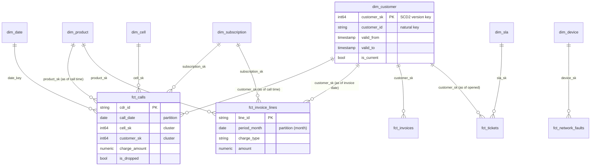

# Gold data model (star schema)

GitHub renders the diagram below. Every fact foreign key resolves to a dimension row;
unresolvable references point to the **Unknown member (`-1`)**, so facts are never dropped.

## Facts

| Fact | Grain | Partition / cluster | Key measures |
|---|---|---|---|
| `fct_calls` | one call detail record | day of call / cell, customer | charge, duration, data, dropped |
| `fct_invoice_lines` | one invoice line | billing month / customer, charge type | amount |
| `fct_invoices` | one invoice | billing month / customer, status | total, lines total, paid, outstanding |
| `fct_tickets` | one trouble ticket | month opened / customer, priority | resolution hours vs SLA, breach |
| `fct_network_faults` | one network alarm | day raised / device, severity | duration, ticketed? |

## Dimensions

| Dimension | Type | Notes |
|---|---|---|
| `dim_customer` | SCD2 | from snapshot; first version valid from 1900-01-01 |
| `dim_product` | SCD2 | price history |
| `dim_subscription` | Type 1 | msisdn -> customer/product bridge; `is_orphan` flag |
| `dim_cell`, `dim_device` | Type 1 | denormalised with site (star, not snowflake) |
| `dim_sla` | Type 1 | targets per tier x priority |
| `dim_date` | static | 2018-2027, `date_key` = YYYYMMDD |

## Marts

| Mart | Purpose |
|---|---|
| `mart_revenue_assurance` | Rated usage vs billed usage per subscription per month: MATCHED / LEAKAGE / UNBILLED_NO_ACCOUNT / UNDER / OVER_BILLED |
| `mart_cell_daily` | Calls, drops, drop rate per cell per day (pre-aggregated for dashboards) |

## Reconciliation built into the model (dbt tests)
- `keys_match_source`: each fact has exactly one row per Silver key (no loss, no fan-out)
- `column_sum_matches`: money and counts in Gold equal Silver to the penny
- `scd2_valid_ranges`: versions have no gaps/overlaps and exactly one current row
- `relationships`: every fact key exists in its dimension
